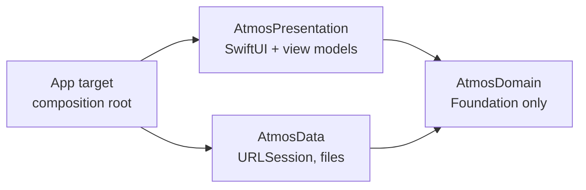

# Atmos — iOS

**A weather app built step by step, as a public tutorial on professional iOS development
with Clean Architecture, SwiftUI and an AI coding agent.**

<!-- step-banner:start -->
## 📍 You are on Step 04 of 7 — Data layer: the app's backend on the phone

`step-04-data-layer` · [← Step 03](https://github.com/AhmedJAbuSada/atmos-ios/tree/step-03-domain-layer) · [Step 05 →](https://github.com/AhmedJAbuSada/atmos-ios/tree/step-05-presentation-ui) · [All steps](docs/ROADMAP.md)

**What this step is.** Everything that talks to the outside world, behind the domain's protocols: Codable DTOs that mirror the JSON, a one-method `HTTPClient` protocol over `URLSession` with a retry decorator, mappers that read local API times in the place's time zone, a `JSONFileStore` actor for the cache and saved cities, `UserDefaults` settings, CoreLocation with iOS 17's `CLLocationUpdate`, and 37 tests on the real recorded responses that run even on Linux.

**Why it matters.** DTOs change when the API changes; entities change when the product changes. Keeping them apart, and translating errors once at the edge, means the app never sees `URLError` or a JSON key. Only `DataModule` is public, so the app can only use domain protocols.

**What you will find in this branch**

| Where | What |
|---|---|
| `Packages/AtmosKit/Sources/AtmosData/Remote/` | DTOs, HTTPClient + retry, OpenMeteoAPI, error mapping |
| `…/AtmosData/Mappers/` | DTO → entities (time zones, parallel arrays) |
| `…/AtmosData/Local/` | JSONFileStore actor, locale-proof cache key |
| `…/AtmosData/Repositories/` | Conformances to the domain protocols |
| `…/AtmosData/DataModule.swift` | The only public type |
| `Packages/AtmosKit/Tests/AtmosDataTests/` | 37 tests reading docs/api/samples |

**How to study this step**

1. **Read the full guide:** [docs/steps/04-data-layer.md](docs/steps/04-data-layer.md): key ideas, diagrams, and *how the AI agent helped* (including what went wrong).
2. **See exactly what this step changed:** [compare with step 03](https://github.com/AhmedJAbuSada/atmos-ios/compare/step-03-domain-layer...step-04-data-layer).
3. **Run it:**
   ```bash
   (cd Packages/AtmosKit && swift test)
   ```
4. **Try the exercise:** Add `uv_index_max` to the daily forecast: DTO → mapper → entity → a test with a new recorded sample. Compare with the same exercise on Android.

> This README shows the project *as it was at this step*. The finished app is on
> [`main`](https://github.com/AhmedJAbuSada/atmos-ios).

---
<!-- step-banner:end -->


-blue)


> 🚧 **In progress:** steps 01–04 of 7 are done. Follow along in [PROGRESS.md](docs/PROGRESS.md).
> The [Android version](https://github.com/AhmedJAbuSada/atmos-android) is complete (v1.0.0).

## Why this repository exists

Most sample apps show only the finished code. This one shows **how a professional project
grows**, one level per branch, each explained:

| Step | Branch | What you learn |
|---|---|---|
| 01 | [`step-01-planning`](../../tree/step-01-planning) | PRD, user stories, API contract, architecture, ADRs, team process, AI agent rules |
| 02 | [`step-02-project-structure`](../../tree/step-02-project-structure) | Swift package targets that enforce Clean Architecture, XcodeGen, SwiftLint, CI |
| 03 | [`step-03-domain-layer`](../../tree/step-03-domain-layer) | Entities, use cases, typed throws, Swift Testing |
| 04 | [`step-04-data-layer`](../../tree/step-04-data-layer) | URLSession + Codable, mappers, JSON file cache, settings, location |
| 05 | `step-05-presentation-ui` | Design system, SwiftUI screens with previews (dark, RTL, Dynamic Type) |
| 06 | `step-06-integration` | `@Observable` view models, navigation, permissions, real data |
| 07 | `step-07-quality-release` | UI tests, screenshots, accessibility, release |
| — | `main` | The finished app |

Full details: [ROADMAP.md](docs/ROADMAP.md).

## The same app on four platforms

| Platform | Repository |
|---|---|
| Android (Kotlin, Compose) | [atmos-android](https://github.com/AhmedJAbuSada/atmos-android) |
| **iOS** (Swift, SwiftUI) | you are here |
| React Native (TypeScript) | [atmos-react-native](https://github.com/AhmedJAbuSada/atmos-react-native) |
| Flutter (Dart) | [atmos-flutter](https://github.com/AhmedJAbuSada/atmos-flutter) |

Same product documents, same architecture, same seven steps. Compare how each platform
solves the same problem: Hilt vs a hand-written composition root, Room vs JSON files,
`StateFlow` vs `@Observable`.

## Features (v1.0)

- 📍 Current weather at your location
- 🕐 Next 24 hours and 🗓 next 7 days
- 🔍 City search with names in your language, ⭐ saved cities
- 📴 Works offline with the last known data
- 🌡 °C / °F, km/h / m/s / mph
- 🌙 Dark mode
- 🌍 **English, Türkçe, العربية** (full right-to-left layout)

> **Note on translations:** the Turkish and Arabic texts are written with an AI agent and
> have **not yet been reviewed by a native speaker**. Corrections are welcome.

Weather data by [Open-Meteo.com](https://open-meteo.com/). No API key is needed.

## Architecture at a glance



Each layer is a Swift package target, so the compiler enforces the dependency rule. Read
[ARCHITECTURE.md](docs/architecture/ARCHITECTURE.md).

## 🤖 Built with an AI agent, the professional way

- [**AI_WORKFLOW.md**](docs/AI_WORKFLOW.md): spec → plan → review → build → verify → review.
- [**AGENTS.md**](AGENTS.md): the rules every AI session loads.
- [**docs/ai/prompts/**](docs/ai/prompts/): the real prompts used at each step.
- Every step guide ends with **"How the AI agent helped in this step"**, including what
  went wrong.

## Start reading

1. [Step 01 guide](docs/steps/01-planning.md)
2. [PRD](docs/product/PRD.md) → [User stories](docs/product/USER_STORIES.md)
3. [Architecture](docs/architecture/ARCHITECTURE.md) → [ADRs](docs/architecture/adr/)

## Author

**Ahmed J. AbuSada**, senior mobile and front-end developer.
GitHub: [@AhmedJAbuSada](https://github.com/AhmedJAbuSada)

## License

[MIT](LICENSE). Weather data © Open-Meteo.com, [CC BY 4.0](https://creativecommons.org/licenses/by/4.0/).
