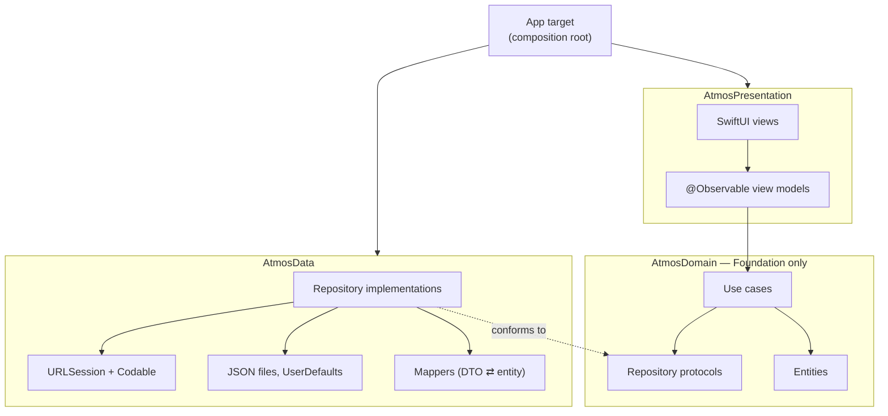
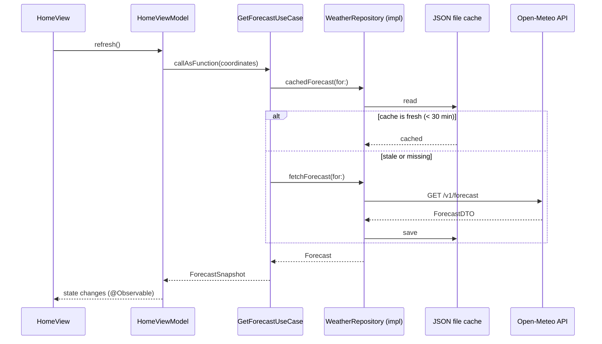

# Architecture

Atmos for iOS follows **Clean Architecture** with three layers, the same as the
[Android version](https://github.com/AhmedJAbuSada/atmos-android/blob/main/docs/architecture/ARCHITECTURE.md).
This document explains the *rules* for Swift. The *reasons* are in the [ADRs](adr/).

## 1. The one rule: dependencies point inwards



- **AtmosPresentation** depends on **AtmosDomain**.
- **AtmosData** depends on **AtmosDomain** (it *conforms to* the domain's protocols).
- **AtmosDomain** depends on **nothing** but Foundation: no SwiftUI, no UIKit, no
  CoreLocation, no URLSession code.
- Only the **App target** sees everything. It builds the object graph in one place,
  `AppContainer` (ADR-0004).

> **Why?** The business rules ("data older than 30 minutes is stale", "convert °C to °F",
> "the current location is always first") change least and matter most. With no framework
> imports, they compile and test on any platform in milliseconds, even on Linux. The
> network or storage code can be replaced without touching a single rule.

## 2. Targets: the compiler enforces the rule

The layers are **targets of a local Swift package**, `Packages/AtmosKit`. A target can only
import what `Package.swift` lists as its dependencies, so `import AtmosData` inside
`AtmosPresentation` is a compile error, not a code-review comment.

| Target | Depends on | Contains |
|---|---|---|
| `AtmosDomain` | — | Entities, repository protocols, use cases, `DomainError` |
| `AtmosData` | `AtmosDomain` | DTOs, API client, mappers, JSON file store, settings store, location, repository implementations |
| `AtmosPresentation` | `AtmosDomain` | SwiftUI views, view models, design system, formatting, String Catalog |
| App target (`App/`) | all three | `@main` app, `AppContainer`, assets, `Info.plist` |

```
atmos-ios/
├── project.yml                 → XcodeGen spec; generates Atmos.xcodeproj (ADR-0008)
├── App/                        → app target: entry point + composition root
└── Packages/AtmosKit/
    ├── Package.swift           → the dependency rule, written down for the compiler
    ├── Sources/
    │   ├── AtmosDomain/
    │   ├── AtmosData/
    │   └── AtmosPresentation/
    └── Tests/
        ├── AtmosDomainTests/
        ├── AtmosDataTests/
        └── AtmosPresentationTests/
```

## 3. Folders: by feature inside each target

```
Sources/AtmosDomain/
├── Weather/     Forecast, WeatherCondition, GetForecastUseCase …
├── Location/    Coordinates, City, Place, SearchCitiesUseCase …
├── Settings/    UserSettings, Temperature, WindSpeed …
└── Common/      DomainError, Clock
```

## 4. Data flow (one request, end to end)



## 5. Rules per layer

### Domain
- `import Foundation` only. No Apple UI or system frameworks.
- **Entities** are immutable `struct`s, `Sendable` and `Equatable`, with domain names
  (`temperature`, not `temperature_2m`).
- **Use cases** are small `struct`s with one `callAsFunction`, named `VerbNounUseCase`.
- **Repository protocols** speak in entities, never DTOs. They are `Sendable`.
- Errors are typed: functions are `async throws(DomainError)` (ADR-0006). No library
  error type crosses a layer boundary.
- Time comes from an injected `Clock`, never `Date()` directly, so tests control it.

### Data
- **DTOs** are `Decodable` structs that mirror the JSON; every field is optional.
- **Mappers** are pure functions, tested against the recorded samples in
  [`docs/api/samples`](../api/samples/).
- Repositories turn every `URLError`, `DecodingError` and HTTP status into a
  `DomainError` at the boundary.
- Types are `internal` unless the composition root needs them.

### Presentation
- **Unidirectional data flow:** a view reads one state value from its view model and calls
  methods for user events. Views hold no business logic.
- View models are `@MainActor @Observable final class`es with a `state` enum.
- Screens are split into a **container** (owns the view model) and a **content view**
  (takes `state` and closures), so every state can be previewed without a view model.
- All user-facing text comes from the **String Catalog** (`Localizable.xcstrings`) in
  English, Turkish and Arabic.
- Formatting (numbers, dates, units) uses the **app locale** from the environment.

## 6. Cross-cutting concerns

| Concern | Where | How |
|---|---|---|
| Dependency injection | App target | `AppContainer`: plain initializers, no framework (ADR-0004) |
| Concurrency | everywhere | Swift 6 strict concurrency; repositories are `actor`s or `Sendable` structs; view models on `@MainActor` |
| Localization | Presentation | String Catalog, ADR-0005 |
| Settings | Data (`UserDefaults`) → Domain (`UserSettings`) | Exposed as an `AsyncStream`, so the UI updates instantly |

## 7. Testing strategy

| Layer | Test type | Tools | Target |
|---|---|---|---|
| Domain | Unit | Swift Testing, in-memory fakes | ≥ 90% |
| Data | Unit + integration | Swift Testing, a stubbed `URLProtocol` replaying the recorded samples | ≥ 80% |
| Presentation | View model tests; UI tests; screenshots | Swift Testing, XCUITest | Every view model; key flows |

Domain and data tests run with `swift test`, also on Linux; presentation and UI tests run on
macOS in CI.
